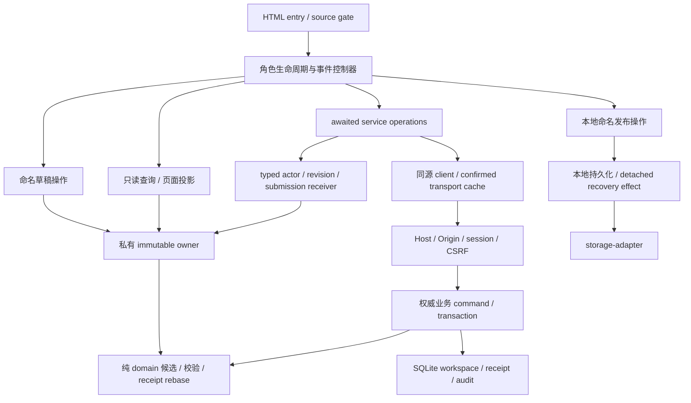

# Website 架构与维护边界

当前产品同时支持独立的浏览器本地模式和真实账号服务模式。两者共用页面及纯领域规则，持久化、授权和失败语义各自明确。服务模式已经连接 SQLite、认证、权限、预约、商议及管理员操作；支付、邮件发送、密码找回和正式外部部署仍不属于已接通能力。

## 入口和来源选择

需要 Node 24.22.1 或更新的兼容版本，使用原生 ES Modules 和内置 `node:sqlite`。不引入 UI 框架或运行时 npm 后端依赖。

| 命令／来源 | 用途 | 数据边界 |
| --- | --- | --- |
| `npm run dev`，默认 loopback 4173 | 原静态／本地工作台，可选路线代理 | 原网址 localStorage 和本机草稿，不提供账号或共享预约库 |
| `npm start`，默认 loopback 4174 | 已组合真实认证、业务 API 与页面服务 | 站点目录外的 SQLite；不自动 seed、导入浏览器数据或创建管理员 |
| 真正静态 API 404／`file:` | 兼容原本地数据与演示 | 只在首次探测明确确认不存在服务时进入本地模式 |

七个真实模块入口分别服务教练、学生、管理员页面、三者现有登录页和公开教练资料页；`index.html` 另为无模块的角色入口页面。HTML 每页加载一个 entry；entry 等待 session 和适用的 bootstrap，再 lazy import role app／state。不能将此 lazy gate 改成提前实例化本地 owner 的静态 import。

`js/service/client.js` 一旦确认服务，断网、超时、401、403、5xx、损坏 JSON 或不完整成功都不会降级成本地成功。`access=full` 只保留原本地用途，不是服务授权。缺少服务资料时返回不可用／真实账号空壳，不安装 Maya、课程、路线或预约默认值。账号范围变化要求重新登录或载入。

分角色入口现分别只登录学生／教练／管理员；正确凭据但错入口不签发会话、不自动分流，用户主动前往正确入口。已有身份先显示账号与角色；切换须真实退出后重新进入当前入口。公开时间表由 `student/index.html?view=public` 的只读匿名客户端读取（credentials:omit），保留原cookie及现有3小时flags公开规则，不把已登录私有投影当公开数据。admin沿用独立专用登录／管理地址，公共导航不显示；管理HTML与API分别由服务端验证权限。OJO独立视觉预览未混入本分支。

## 依赖、提交和事实接收

`domain` 不依赖 DOM、storage、runtime 或可变 state；`core` 不依赖页面／角色 DOM。`core/scheduling-rules.js` 绑定当前 owner、配置、目录和 clock，形成来源一致的排程 operation。服务端 `schedule-authority` 从权威事务事实绑定同一纯核，不导入浏览器 core。

所有业务状态只有 state owner 具有提交权。查询／渲染不保存，也不通过 DOM 刷新制造业务版本。transport cache 保存最后确认的不可变服务投影，不是编辑草稿或另一套撤销历史。纯计算与 boundary 校验都不能代替权威提交。

## 本地初始化、存储与兼容

`initializeApplicationData()` 是明确的初值来源分派：服务初值只来自确认 bootstrap；本地调用资源初始化流程。普通只读、解码和渲染不隐含初始化；公开资料页在入口中明确执行 `initializeLocalProfileData()`，只迁移资料，不安装 slots／requests。服务模式误调用该本地入口被拒绝。

`local-initialization-plans.js` 产生 slots／profile 初值和可选 writeBack，自己不读写存储。默认 profile、课程、第一冰场和 demo 迁移依赖由应用边界显式提供。bootstrap 执行原有顺序：读排期／必要写回，读资料／必要迁移写回，再读 envelope 缺失字段的旧 key。它返回实际写入回执，失败不代表已持久保存。

- `domain/schedule-codec.mjs` 是旧对象数组／v2 compact row 的唯一字段表和 wire 实现，所有调用直接导入；core 不再转导出。
- `core/storage-codecs.js` 只保留纯 profile 兼容、scheduling 形状和 legacy array 转换，无 mutable config／demo 依赖；profile 默认值显式传入，normalizeProfile 为内部实现。
- `data-store.js` 负责本地保存、原有恢复、已存快照和用户主动备份。测试专用的旧 loadProfiles/loadSlots/loadBookingRequests/loadSchedulingData 导出已退出。blocked 的真实 legacy fallback 仍为内部实现。
- `readLocalScheduleSnapshot()` 和 `refreshLocalScheduleFacts()` 明确只用于本地；服务模式不读 localStorage，也不把 client cache 假装成本地存储。
- 旧 `receivePublishedSchedule()` 只接收本地已保存事实，服务误调用在修改前拒绝。服务更新必须走专用 receiver。

| 保留 key | 用途 |
| --- | --- |
| `ice-skating-coach-profiles-v2` | 已保存资料／课程与未知字段 |
| `ice-skating-coach-booking-slots-v12` | version2 envelope：slots／scheduling／blockedExceptions／bookingRequests 与 extras |
| `ice-skating-coach-blocked-exceptions-v1` | envelope 缺字段时的旧来源 |
| `ice-skating-booking-requests-v1` | envelope 缺字段时的旧请求来源 |
| `ice-skating-coach-active-panel-v1` / `ice-skating-student-active-panel-v1` | 原角色导航偏好 |

旧可读空数组不会被当成损坏数据重置。损坏输入、缺失默认、profile 价格／照片／课程兼容和 demo 补数据仍保持原合同；unknown 字段、compact 顺序和预约历史价格不重写。本地启动的兼容规范化与 raw snapshot 读取有历史差异，不能宣称所有旧数据已被统一清洗。

普通 storage 读取保留原 memory fallback；`readStorageItemResult` 则严格区分缺 key(null)和读取失败，仅供可靠完整备份等明确用途。内存可读不等于持久保存。用户点击本地导出只读取四个已知 key，不扫描、不写、不联网；保留可导入 source 与私密原文。service 不自动读取旧 origin，用户主动选文件并映射后才检查／追加。完整备份20MiB与服务请求2MiB是不同限制。

排期保存失败后的旧照片恢复仍跨资源：可能先删除／重写资料再重试排期，且不限 quota；即使最终排期失败也可能改变照片。store 返回 detached recoveredProfiles 和各步真实 outcome，由 owner 显式接收，不反向修改入参。此策略及 memory fallback 的历史一致性问题不因分层自动变安全，需另作正确性验收。本地 reset 也不是跨 key 事务；普通点击先确认备份，服务模式拒绝。

## 草稿、发布、ACK 与撤销

开放时间、规划和资料草稿与 published/saved 分离；学生查询使用已发布事实。覆盖的 base/overlay/provenance 不依赖撤销栈长度，恢复草稿不能撤销后来成立的预约。每个排程操作捕获一致来源与产品 clock；后续写入后开始新操作。

`state.js` 独占 identity/revision/sequence、私有 WeakMap submission handle、确认状态和一次 commit。纯计算在 `domain/service-receipt.mjs`、`profile-rebase.mjs`、`availability-publication.mjs`：计算候选、三方重接、提交范围与历史变换，不持有提交权或网络能力。不得暴露 raw state 或通用 patch API。

`service/operations.js` 在第一次 await 前冻结实际 command payload 并 capture 提交。`receiveServiceProjection` 只接收完整且身份／版本合法的事实；旧 actor、旧 revision／sequence 被拒绝。cache 更新本身不能更新 owner，更不能从本地 receiver 绕过确认。

confirm 只确认匹配 command 的实际已提交路径。部分 payload、未发送的未知字段、后来输入和后来 undo 历史仍保留；重复 ACK 不清掉后来编辑。booked rows 与历史价格始终取真实服务事实。safe publication 的 acceptedSafety 只留在客户端私有 capture；合法 metadataSourceId 才可显式继承已有供给元数据，不创造授权。详见 [client 合同](product-client.md) 与 [业务 wire 合同](product-domain.md)。

`ok`、`committed`、`applied` 各有语义：结果未知可能已提交，必须保留原 immutable command/key/body/handle 显式重试；已提交但未同步先刷新；409 需刷新／合并后明确重新提交。刷新不证明未知提交失败。服务预约撤销使用 actor-scoped token 与当前记录校验，不恢复全局旧快照。本地发布／撤销仍以真实持久化结果决定成功，不因 Promise/object truthiness 清草稿。

## 真实后端、权限与 HTTP

`server/app-server.mjs` 组合 product HTTP 和 `createProductApi()`。认证负责密码 scrypt、cookie hash、CSRF、过期、撤销及 durable rate limits；HTTP 先校验 Host／exact Origin，读 body 后重验身份，业务事务内再读取 actor。多次校验跨越不同信任／await 边界，不能合成只检查一次。

`store.transaction(fn)` 仅接受同步、不嵌套函数；BEGIN IMMEDIATE 内将 workspace CAS、receipt、audit 一起提交／回滚。actor+key 同 fingerprint 返回原回执，不因重试重新定价／预约；不同内容同 key409。严格持久形状校验和 business optional defaults 职责不同，未合成万能 normalizer。

学生只得到公共目录、可执行 offer、匿名 foreign busy 和本人资料；匿名 bootstrap 仅3h flags。教练只管理本人；管理员的用户、资料、冰场、场次和独立授权操作仍受服务校验。账户批准不等于某冰场许可；停用／移除许可／停场不取消既有预约。历史导入 append-only，显式 coach／逐记录 student mapping，不按邮箱认领。所有 DTO 排除密码/hash/token；未知持久字段不自动成为公共字段或权限。

| 接口 | 权责 |
| --- | --- |
| `/api/auth/session`、login/register/logout/change-password | 真 session／权限身份；无公开 admin 注册；找回接口诚实501 |
| `/api/bootstrap`、`/api/coaches/:id/public`、`/api/availability` | 分角色／公开投影及权威 offer 查询 |
| `/api/commands` | expectedRevision + Idempotency-Key，事务内重验业务与权限 |
| `/api/schedule/preview` | 只读已发布事实／配置预览，不是未保存草稿或预约批准 |
| `/api/scheduling/status`、`/api/scheduling/route` | 共享 scheduling-routes handler；可选 provider，product POST 另有认证／Origin／CSRF |

路线 handler 不再通过构造 dev server 抽 listener 复用。相同 product JSON 输出在纯叶 json-response；auth/business 错误脱敏仍各自承担。public identity leaf 保留 auth 完整字段/null 默认与 business own-field/order 适配差异。旧 dev 404、route null/provider500 与 product unhandled501 不在结构重构中偷改。

DB 必须使用站点外绝对路径。product 静态服务对原 URL 和最终 canonical 目标应用相同私有 segment 规则，并做 realpath containment、普通文件及 MIME 检查；目录 index 也经同一校验。公共 symlink 仍可用，根上方的点目录不受站点私有规则误拒。不能用 legacy resolver 替代。独立真实 HTTP/FS 的 100 案例已覆盖这些合同；该目录仍由 operator 控制，不是任意上传沙箱或防止并发恶意重写目录的保证。

## 角色与控件生命周期

coach/app、student/app/service-app、admin/app 持有各自挂载与 destroy；重复 init 不重复绑定，旧异步结果不能回写新挂载或新账号 DOM。局部 drafts 不因普通刷新或整体重绘丢失。DOM 引用按角色组织；外部文本经 DOM/textContent 或 safe-html，不能恢复隐藏外角色 DOM／全局函数。

教练预约 `read-model.js` 在一次操作边界捕获 owner、产品时钟及筛选；纯 `queries.js` 为列表、日历、筛选和请求提供共享事实及索引，不从 renderer 导出业务查询。`booking-status.js` 只映射明确的 status/past/cancelled，三个实际调用方使用同一规则时钟，不再按浏览器时区另算结束状态。

`bookings/request-editor.js` 负责 receive/choose/reset，`request-state.js` 唯一拥有选中请求。renderer 只投影；同一请求的原始输入留在原生节点，只有显式重置或选中对象变化才写值。规划设置的明确重置接口为 `resetSchedulingSettingsEditor`；后台投影保留输入，通勤方向按 key 保留节点。旧 DOM snapshot→重画→restore 的两层 wrapper 和调用已删除。

教练服务操作的 pending/receipt 记账独立于 mounted view。终态先结算；销毁释放旧 view 回调，当前 view 只用自己的接收入口刷新。actor-scoped receipt recorder 只接续业务 undo；unknown 或已提交未同步保留原 immutable operation，不能另造命令。此处只支持同页卸载/重挂，不增加跨刷新 undo。

共享预约详情 DOM 与学生预约表单 DOM 分别由 `booking-details-elements.js`、`student-booking-elements.js` 拥有；反馈 presenter 接收明确节点/颜色，角色保留各自后续动作。旧混合 DOM aggregate、无逻辑 profile actions barrel、过时 shared refresh alias、77 个历史 CSS selector 分支及学生假登录 form 已退出；真实登录入口和本地旧数据恢复仍保留。

日期、时间、锚点定位和非模态资源按真实共同职责复用。管理员时间组件由 editor scope 持有共享 document picker，app 不再增加第二 owner；动态停场行由同一观察器发现。原生键盘、coarse／不支持能力 fallback、AMPM 格式、24:00 禁用 end 保持。局部布局与共享视觉规则分别维护，不借本轮实施 OJO 大重排。

## 运行、验证与范围

部署／管理员初始化见 [foundation](product-foundation.md) 与 [admin](product-admin.md)。synthetic seed 只用于指定新测试库；marker 后不自动滚动、不覆盖已有用户或预约。正式初始 admin 使用显式 stdin CLI，不提供默认管理员密码。

默认 `npm test` 隔离进程运行适合 Node/jsdom 的各组，失败继续其它组并最终非零；browser 测试另用 `npm run test:browser`。使用实际 Node24。`npm run check` 做语法、实际 HTML module entry 打包、静态边界／环和 tracked diff；新增文件也要独立查空白。动态 import 实际入口图由实际打包图补查，不把 regex 无环或模块可达误当函数迁移完成。

无 Git 副本可运行默认测试和 syntax/module 检查本体；`npm run check` 的最后 git diff 步骤需要 Git，非 Git 验证应单列运行前两个脚本并检查交付差异。测试日志需记录源码 hashes、实际范围和运输方式，不把历史组数当现状。

受限 worker 明确使用既有 `PRODUCT_FOUNDATION_TEST_TRANSPORT=dispatch` 执行同 listener／SQLite 断言时，必须标 NO TCP，保留实际 EPERM；不能把它说成真实 HTTP/browser。父独立执行真实 TCP、noGit、三端 headless、长序列／失败／并发与预约完整性验收。

单次与每周修改、临时换场、循环起止／默认无限重复、不可预约入口归属、拖拽新版进入退出／持续／浮条继续 pending。现有已确认流程保持；外部地图／消息／收费、生产部署和 OJO 视觉不在本次架构变更中实施。
